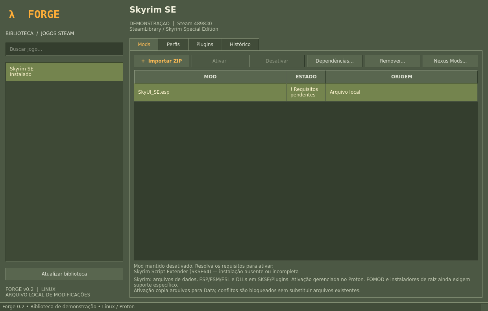

# Forge Mods — Linux · 0.2

Organizador desktop de mods em Python e Qt/PySide6, em português, com visual inspirado na Steam clássica e em Half-Life. Descobre instalações Steam, mantém uma biblioteca por jogo e gerencia arquivos e plugins de Skyrim clássico e Skyrim Special Edition no Proton.



## Executar

Requer Linux, Python 3.11+ e PySide6:

```bash
git clone git@github.com:Mattdolne/forge_mods.git
cd forge_mods
python3 -m venv .venv
source .venv/bin/activate
python -m pip install -r requirements.txt
./run.sh
```

Em instalações mínimas Debian/Ubuntu, Qt também precisa das bibliotecas do sistema `libegl1`, `libgl1`, `libopengl0` e `libxkbcommon0`. O workflow do GitHub instala essas bibliotecas antes dos testes.

A cópia de desenvolvimento solicitada pelo usuário fica em `~/Documentos/projetos/forge-mods`. Quando PySide6 já está instalado no Python ativo, basta executar `./run.sh` nessa pasta.

## Funcionalidades

- Detecta bibliotecas Steam nativas e Flatpak pelos arquivos locais, sem login Steam. Mantém jogos previamente detectados quando desinstalados. Ferramentas e runtimes Steam também podem aparecer.
- Importa ZIPs para uma biblioteca fora da pasta do jogo. Todos os mods importados começam desativados.
- Instala e ativa arquivos de dados e plugins ESP/ESM/ESL de Skyrim. Aceita DLLs que já estejam na estrutura `SKSE/Plugins`.
- Localiza o prefixo Proton e atualiza `plugins.txt` e `loadorder.txt`; em Skyrim SE usa `*Nome.esp` para plugins ativos. Preserva os registros e comentários de outros mods.
- Detecta masters exigidos por plugins, bloqueia ativação com dependências ausentes/inativas e informa os nomes.
- Reconhece a dependência SKSE de SkyUI e de plugins nativos em `SKSE/Plugins`. Exige loader, DLL de runtime e `Data/Scripts/SKSE.pex`; isso não garante compatibilidade de versão nem execução correta.
- Permite cadastrar outros requisitos descritos pelo autor, pelo nome exato do mod na biblioteca.
- Bloqueia desativação de um mod exigido por outro mod ativo.
- Exibe uma aba Plugins e permite mover plugins na ordem, impedindo violações das dependências declaradas e da precedência de masters. Não implementa as regras adicionais do LOOT.
- Desativa e remove arquivos gerenciados, verifica hashes antes de remover e bloqueia conflitos com arquivos existentes.
- Salva/restaura conjuntos em perfis, ordenando a ativação por dependências. Mantém histórico inclusive após remover um mod da biblioteca.
- Guarda backups das listas de plugins e um journal para recuperar operações interrompidas. Uma trava impede duas instâncias na mesma biblioteca.

## Usar

1. Inicie Skyrim uma vez pela Steam para criar o prefixo Proton e feche o jogo.
2. Abra Forge e selecione o jogo. Use **Atualizar biblioteca** se necessário.
3. Baixe um mod ZIP manualmente e use **Importar ZIP**. O link do Nexus é opcional.
4. Se houver requisitos pendentes, o Forge mostra seus nomes e mantém **Ativar** indisponível. Instale/ative as dependências e atualize a biblioteca. Nenhum mod é ativado automaticamente depois disso: selecione-o e clique em **Ativar**.
5. Use **Dependências...** para cadastrar requisitos que estejam apenas na descrição do autor, um nome por linha exatamente como aparece na biblioteca. Requisitos automáticos de masters/SKSE não podem ser removidos por esse campo.
6. Use **Plugins** para conferir o prefixo e a ordem. Se a detecção do Proton não encontrar a instalação correta, selecione manualmente a pasta `pfx` que contém `drive_c/users`.
7. Salve um perfil antes de desinstalar o jogo. Depois da reinstalação, atualize a biblioteca e restaure o perfil. Desinstalar o jogo não apaga as cópias da biblioteca do Forge.
8. **Desativar** remove a implantação e seus registros de plugins. **Remover...** também apaga a cópia da biblioteca e as referências nos perfis; o histórico permanece.

### Exemplo: SkyUI

O plugin `SkyUI_SE.esp` declara `Skyrim.esm`, que faz parte do próprio jogo. SkyUI também requer **Skyrim Script Extender (SKSE64)**. Sem uma instalação detectável do SKSE64, o Forge importa SkyUI, informa a dependência e mantém o mod desativado. Depois de atender o requisito, a ativação copia o ESP/BSA e registra `*SkyUI_SE.esp` no prefixo Proton.

SKSE deve ser compatível com a versão do Skyrim e o jogo deve ser iniciado pelo seu loader. Esta versão não instala nem configura automaticamente o carregador do SKSE. Referências: [SkyUI no Nexus](https://www.nexusmods.com/skyrimspecialedition/mods/12604) e [instruções do SKSE64](https://github.com/ianpatt/skse64/blob/master/skse64_readme.txt).

## Limites atuais

- Downloads integrados, conta/API Nexus e links `nxm://` foram adiados. O botão Nexus abre o navegador.
- O ZIP não revela necessariamente todos os requisitos do autor. A detecção cobre masters dos plugins e as regras SKSE descritas acima; outros requisitos devem ser cadastrados manualmente. Ainda não há verificação de versões de dependências.
- FOMOD, instaladores executáveis/raiz, arquivos 7z/RAR e instalação automática do SKSE não são suportados. Pacotes FOMOD podem ser guardados na biblioteca, mas sua ativação é bloqueada.
- O layout esperado é relativo a `Data`, `Data/...` ou uma pasta externa contendo `Data/...`. Estruturas arbitrárias precisam ser reorganizadas.
- Não sobrescreve arquivos existentes: sobreposições exigem resolução prévia. Ainda não mantém camadas de prioridade entre mods.
- Não gerencia saves, Steam Cloud ou compatibilidade semântica entre mods. Outros jogos detectados precisam de adaptadores de instalação próprios.
- Feche o jogo e outros gerenciadores antes de alterar mods. A recuperação foi testada para interrupção de operações; durabilidade contra falha física de disco/energia não foi certificada.
- Discos desmontados podem aparecer como jogos não instalados; remonte e atualize a biblioteca.

## Dados locais

Padrão: `$XDG_DATA_HOME/forge-mods` ou `~/.local/share/forge-mods`.

| Caminho | Conteúdo |
| --- | --- |
| `library.sqlite3` | Jogos, mods, arquivos, perfis, dependências e histórico |
| `mods/<id>/` | Cópias extraídas dos mods |
| `backups/<id>/` | Listas de plugins anteriores e manifesto dos caminhos |
| `transactions/<id>/` | Journal e snapshots de operações em andamento |

Faça backup da pasta inteira com o programa fechado. Para testes isolados use `FORGE_DATA_DIR=/caminho/temporario`.

## Desenvolvimento e testes

```bash
QT_QPA_PLATFORM=offscreen python3 -m unittest discover -s tests -v
```

A suíte usa instalações sintéticas, incluindo prefixos Proton, cabeçalhos TES4 e cliques reais na interface. Cobre dependências, bloqueio do SkyUI sem SKSE, ativação/desativação, ordem, perfis, remoção, preservação de configurações, rollback, recuperação e validação de ZIPs. O ZIP real do SkyUI também foi exercitado localmente em instalação temporária; não é distribuído neste repositório. Os testes não modificam jogos reais.

Veja [AGENTS.md](AGENTS.md) para as instruções de manutenção, incluindo atualização da documentação, testes, commit e push após cada conjunto de alterações concluído. Veja [CHANGELOG.md](CHANGELOG.md) para o histórico funcional.
